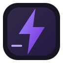

# LocalNitro

<p align="center">
  
</p>

<h1 align="center">LocalNitro</h1>
<p align="center"><strong>A polished, local-first cosmetic companion for Vencord.</strong></p>
<p align="center">
  <a href="https://github.com/AzureMC-projects/LocalNitro/issues">Issues & support</a>
  · <a href="https://docs.vencord.dev/installing/custom-plugins/">Vencord custom plugin guide</a>
  · <a href="https://github.com/AzureMC-projects/LocalNitro/blob/main/CONTRIBUTING.md">Contributing</a>
</p>

> **Important:** LocalNitro does not provide Discord Nitro. It does not alter account entitlements, bypass server checks, unlock server-gated features, change upload limits, or make local changes visible to other people.

LocalNitro is an unofficial Vencord user plugin focused on tasteful client-side customisation. It aims to keep the experience transparent, reversible, and maintainable as Discord changes.

## Features

| Feature | Status | Notes |
| --- | --- | --- |
| Live local accent theme | Implemented | Violet, Ocean, Rose, and Mint palettes |
| Softer-corner styling | Implemented | Uses best-effort Discord CSS selectors |
| Local-only indicator | Implemented | Optional, visible reminder |
| Clean disable / unload | Implemented | Removes plugin-owned classes and attributes |
| Profile / banner preview editor | Planned | Preview-only; no account upload or persistence |
| Media and sticker discovery improvements | Planned | Must respect server permissions and platform rules |
| Compatibility smoke tests | In progress | Must be tested against a real Vencord checkout |

Discord's internal class names and theme variables are not stable APIs. Cosmetic selectors may need updating after Discord client changes.

## Preview

The included theme uses a restrained accent palette and a small optional indicator. A real Discord screenshot is intentionally not included until the plugin has been built and tested against a live client.

## Installation (Windows)

LocalNitro is a **Vencord user plugin**. It is not a standalone Discord installer.

1. Follow the official [Vencord source installation guide](https://docs.vencord.dev/installing/).
2. In your Vencord source checkout, create `src/userplugins/localNitro/`.
3. Copy this repository's `index.ts` and `styles.css` into that folder.
4. Follow Vencord's [custom plugin instructions](https://docs.vencord.dev/installing/custom-plugins/) to rebuild and inject.
5. Restart Discord, open **User Settings → Vencord → Plugins**, and enable **LocalNitro**.

Example PowerShell commands for cloning the Vencord source:

```powershell
git clone https://github.com/Vendicated/Vencord.git
cd Vencord
pnpm install --frozen-lockfile
```

Then copy the two plugin files into `src/userplugins/localNitro/` before building. Follow the current upstream documentation if the build commands change.

## Configure

Open **User Settings → Vencord → Plugins → LocalNitro**.

- **Enable local theme** — turns the accent theme on or off.
- **Accent palette** — choose Violet, Ocean, Rose, or Mint.
- **Softer corners** — applies a subtle radius to selected UI surfaces.
- **Show local-only notice** — displays a small reminder in the corner of the client.

Settings are intended to update without a restart. If a setting does not appear or apply, check the Vencord console for errors and confirm the plugin is in the correct folder.

## Project phases

- [x] **Phase 1 — Foundation:** plugin scaffold, settings, clean lifecycle, documentation.
- [x] **Phase 2 — Visual identity:** palette presets, restrained surface styling, local-only notice.
- [ ] **Phase 3 — Local preview tools:** opt-in profile/banner/avatar mock previews that never upload or change account data.
- [ ] **Phase 4 — Media quality of life:** permission-respecting discovery and preview enhancements.
- [ ] **Phase 5 — Reliability:** test against current Vencord, improve compatibility fallbacks, publish verified screenshots and release notes.

Phases 3–5 are not represented as finished features yet. They require implementation and testing against a real Vencord checkout; this repository should not claim them until verified.

## Development

Vencord user plugins run inside the Discord client and rely on upstream APIs. Read the [official plugin docs](https://docs.vencord.dev/plugins/) before adding patches or UI components.

Suggested workflow:

1. Make changes in `src/userplugins/localNitro/`.
2. Run Vencord's current build or watch workflow.
3. Verify each setting, toggle the plugin off and on, and inspect the console.
4. Test with the current Discord client and check that disabling the plugin removes all plugin-owned DOM state.
5. Update the feature table and changelog only after verification.

## Safety and privacy

- No Discord token collection, external telemetry, or network requests are implemented.
- Local styling only; no claim of Nitro entitlement or server-side capability.
- Do not paste your Discord token into scripts, issues, screenshots, or support chats.
- Client modifications can break after upstream updates and may carry account or stability risks.

See [SECURITY.md](SECURITY.md) for reporting vulnerabilities and [CONTRIBUTING.md](CONTRIBUTING.md) for development guidelines.

## License

Licensed under [GNU GPL v3.0 or later](LICENSE). LocalNitro is an independent community project and is not affiliated with Discord or Vencord.
